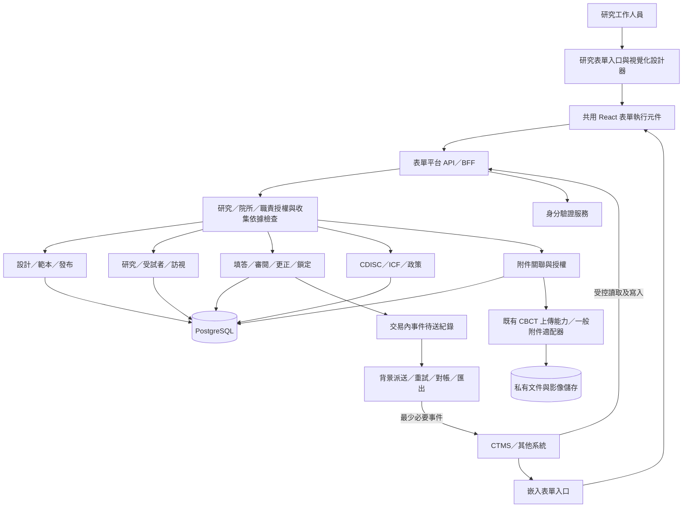
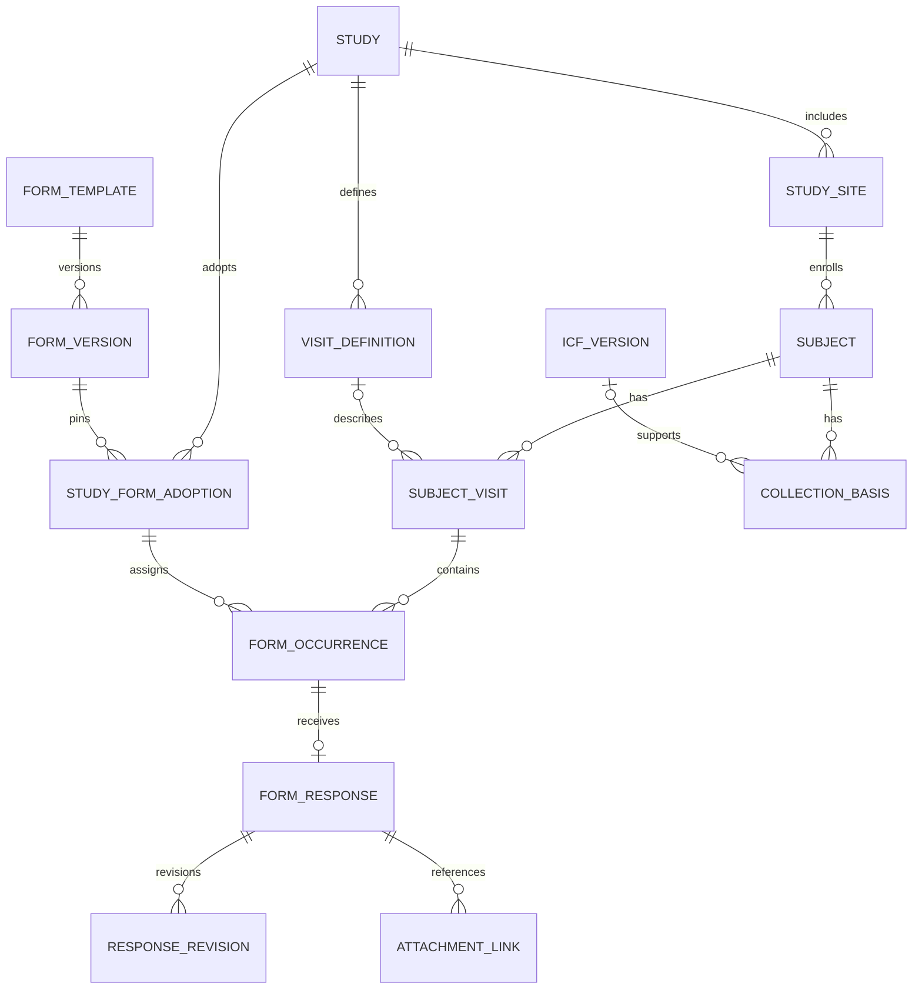

# 研究表單平台：系統架構與開發規劃書

| 項目 | 內容 |
| --- | --- |
| 文件版本 | v0.1 |
| 日期 | 2026-10-28 |
| 狀態 | 供審閱草案 |
| 專案基礎 | Clinical Form Studio／AirwayAI eCRF Studio；整合既有 CBCT 上傳能力 |
| 決策依據 | 已確認的 ADR 0001–0018 |
| 本次交付 | 架構與開發規劃；未開始功能實作或正式部署 |

## 1. 決策摘要

建議將現有專案發展為「可整合的研究表單平台」：研究工作人員透過視覺化編輯器高效率建立 eCRF 與 ICF 文件，利用版本化範本及 CDISC 對應提升一致性，再以同一套表單執行與資料服務，支援平台內填寫、CTMS 內嵌及外部 API 資料交換。

正式填答與更正歷程由本平台保存。CTMS 可提供研究脈絡並取得資料收集進度；既有 CBCT 平台提供上傳與檔案驗證能力。第一版由單一營運單位管理多研究、多合作院所，院端資料預設隔離。

**建議技術方向：React 視覺化設計器與表單引擎，加上 ASP.NET Core 模組化後端、PostgreSQL、私有物件儲存及背景工作。**這是本規劃的技術建議，尚未作為使用者已核准的技術 ADR；具體套件、部署位置與身分供應商於第 0 階段確認。

## 2. 目標與範圍

### 2.1 產品目標

1. 文件／AI 草稿、範本及空白建表，都能進入同一個可持續修改的視覺化編輯器。
2. 同一份已發布表單能在本平台及其他系統使用，保留一致的驗證與版本行為。
3. 將資料明確分類到研究、院所、受試者、訪視、表單及標準語意，供 CTMS 使用。
4. 讓正式填答、更正、核准、附件與資料交換均可追溯。
5. 將同意依據、資料用途與院所權限納入收集控制。

### 2.2 第一版已確認範圍

| 範圍 | 已確認方向 |
| --- | --- |
| 使用者 | 研究工作人員；受試者自填暫不納入 |
| 入口 | 平台入口與外部嵌入；先完成平台入口 |
| 建表 | AI／文件、範本、空白起始，視覺化後續調整 |
| 標準 | 依研究指定必要 CDISC 對應欄位，由人工確認 |
| 重用 | 版本化範本庫，研究明確採用版本及更新 |
| 發布 | 測試可自行發布，正式發布及改版須另一位授權人員核准 |
| 收集 | 訪視、非預定訪視、可重複表單、草稿與送出 |
| 品質 | 審閱、更正理由、重新審閱、鎖定與授權解鎖 |
| ICF | 文件建立、核准版本、已簽文件關聯、同意狀態管理 |
| ICF 保管 | 依研究選擇院端或集中保管，預設院端，文件權限獨立 |
| 附件 | 一般附件與既有 CBCT 上傳整合，分階段交付 |
| 身分 | 平台登入及外部單一登入；研究授權由本平台管理 |
| 整合 | 脈絡對應、讀取／寫入 API、事件及匯出 |

### 2.3 後續擴充範圍

完整電子知情同意及簽署、受試者自填問卷、多客戶自助 SaaS、每客戶獨立部署、完整 CTMS 排程／預算／合約管理，以及自動產生法規提交資料集，均不列為第一版必要交付。

### 2.4 預期成效與量測

試點應量測：建立及改版表單所需時間、重用欄位／範本比例、人工重複輸入次數、送出時錯誤率、資料更正週期及外部同步成功率。第 0 階段先記錄現況，再與研究團隊訂改善目標，不在缺乏基準時宣稱節省比例。

## 3. 現況與差距

以下為程式及既有文件盤點，未在本次重新執行完整測試，也不代表部署環境已驗收。

| 現有資產 | 可沿用部分 | 主要差距 |
| --- | --- | --- |
| `template/crf/src/FormRenderer.tsx`、`engine.ts`、`contract.ts` | JSON 合約、React 呈現、條件及驗證行為 | 後端一致驗證、正式儲存、權限與狀態控制 |
| `template/crf/src/studio/` | YAML 編輯、編譯、來源、人工確認及匯出 | 視覺化操作完整度、多人工作、範本採用及正式改版 |
| `yaml-form-studio/` | 另一套 YAML 審閱介面、語言切換、身分及確認 API | 與本機 Studio 的能力整併；目前 DB schema 為空，不能視為既有 EDC 資料庫 |
| `.codex/skills/` | 計畫書分析、標準候選、QA、發布等工作流程 | 轉成可由產品工作流程呼叫及追溯的能力，不能只依賴聊天紀錄 |
| `output/playwright/`、既有測試 | 表單測試方法與歷史證據 | 新增多院授權、持久化、並發、更正及整合測試 |
| 既有 CBCT 上傳平台 | 院所／專案、登入、上傳續傳、檔案驗證、稽核及保存 | 與研究／訪視的識別對應、附件權限契約及已知上線缺口驗收 |

**整併建議：**以 `template/crf` 的合約與 renderer 作為共用引擎候選；比較兩套 Studio 後收斂為一個產品編輯器。保留目前範例作為回歸基準，先做契約相容性評估，再替換入口，避免同時維護兩套主要建表流程。

## 4. 整體架構

### 4.1 邏輯架構



### 4.2 部署形態建議

先採模組化單體：一套後端內按責任分模組，另有背景工作程序；資料庫依模組分組或 schema 管理。既有上傳服務透過適配器整合，不直接跨資料庫寫入其業務表格。這可先保留交易一致性與單一維運方式，待量測有獨立擴展需求再拆分。微服務數量不作為架構成熟度指標。

此為依本案規模與既有資產提出的建議；架構參考見 [Microsoft 常見 Web 應用程式架構](https://learn.microsoft.com/en-us/dotnet/standard/modern-web-apps-azure-architecture/common-web-application-architectures)。

| 層次 | 建議 | 選擇理由／限制 |
| --- | --- | --- |
| 前端 | React＋TypeScript，分離設計器與執行元件 | 優先沿用現有 renderer，不要求將既有 CBCT Vue 前端重寫 |
| 後端 | ASP.NET Core Controller API／BFF | 既有 CBCT 後端採 `net10.0`，有利重用團隊經驗與身分／儲存適配方式；不預設直接合併兩個產品 |
| 正式儲存 | PostgreSQL；填答內容可用 JSONB，主關聯與版本用關聯資料 | 支援可變欄位，同時保留研究、權限與狀態的明確約束 |
| 文件／影像 | 私有物件儲存，獨立檔案與存取授權 | 大檔不寫入填答 JSON；已簽 ICF 與一般研究附件區分權限 |
| 背景工作 | 持久化工作／事件紀錄，加上重試與失敗處理 | 支援匯出、事件派送及驗證同步，避免 HTTP 請求等待長工作 |
| 身分 | 採成熟身分供應商，先平台登入再外部聯邦登入 | 不自行實作密碼儲存或把登入成功當成研究授權 |
| 執行環境 | 本機容器開發、測試／正式分離；優先評估既有 AWS 環境 | 沿用能力前須核對帳號、區域、成本與資料治理要求，未於本案核准部署 |

### 4.3 前後端規則一致性

共用的是「版本化的宣告式規則與一致行為」，不是假定 TypeScript 可以原樣搬到 .NET。前端用於即時回饋；後端重新檢查型別、必填、選項、範圍、條件及計算依賴。建立共同的輸入／預期結果案例，對前後端分別執行一致性測試。

規則僅允許核准的運算子，不接受表單作者提供任意 JavaScript、SQL 或可執行程式碼。後端計算或核對衍生值，不能信任呼叫者自行計算的結果。

## 5. 模組與責任

| 模組 | 主要責任 | 明確邊界 |
| --- | --- | --- |
| 表單設計與範本 | 文件／AI 草稿、欄位、版面、規則、來源、差異、審閱、發布 | 草稿可修改；正式版本固定，改版另建版本 |
| 研究脈絡與授權 | 研究、院所、研究代碼、訪視、指派、來源與外部代碼 | CTMS 維護模式下不偷偷另建衝突主檔；來源切換須受控 |
| 填答管理 | 草稿、送出、審閱、更正、鎖定、修訂歷程 | 正式紀錄保存在本平台，所有入口走相同規則 |
| 標準及同意政策 | CDISC 對應及版本、ICF 版本、收集依據與用途 | 平台核准不代表 IRB 核准；同意文件收件不代表依據已確認 |
| 附件整合 | 檔案關聯、上傳授權、驗證狀態、受控取得 | 傳輸成功、驗證成功與允許研究使用分開判斷 |
| 對外整合 | API、嵌入、身分交換、事件、匯出與對帳 | 外部系統不能繞過院所、同意、版本或鎖定控制 |

### 5.1 eCRF 與 ICF 的共用及差異

兩者共用草稿、來源、版本、審閱、發布、權限與匯出能力。eCRF 使用欄位／規則模型；ICF 增加章節、核准文字、同意選項與簽署角色區塊，保留可閱讀的文件結構。第一版的 ICF 簽署區供文件呈現與管理，不實作線上電子簽署流程。

ICF 可匯入既有核准文件；有核准依據的內容不能由 AI 自動改寫後仍沿用原核准標示。內容修改產生新版本並重新走適用審核。

### 5.2 AI 的角色

AI 用於解讀計畫書、提出欄位草稿、來源定位、標準候選及差異摘要；人員負責確認臨床語意、必要欄位、標準對應與發布。AI 不自動產生正式核准，也不在受試者資料送出時作為必須在線的依賴。

僅以必要且已授權的研究文件執行 AI 工作；不預設將真實填答、已簽 ICF 或原始可識別影像傳入 AI。AI 工作保留輸入文件雜湊、版本、執行設定與產物關聯，實際供應商與資料處理方式另行確認。

## 6. 資料模型建議

### 6.1 核心關聯



此圖是規劃概念模型；非預定訪視可不對應預定訪視定義。免同意依據可由研究／族群範圍覆蓋多位受試者，不要求每人重複上傳同一份核准文件；實作時另建依據適用範圍。附件也可關聯受試者或訪視，不限於填答。

### 6.2 重要實體

| 實體 | 關鍵內容 |
| --- | --- |
| Study／StudySite | 脈絡維護來源、研究政策、院所、角色指派與有效期間 |
| Subject | 平台 ID、研究代碼、所屬研究／院所；不預設保存姓名與院內病歷號 |
| ExternalIdentifierMapping | 來源系統、實體類型、適用範圍、外部 ID 與平台 ID；明確唯一性約束 |
| FormTemplate／FormVersion | 內容、穩定欄位 ID、規則、語言、來源、狀態、版本及內容雜湊 |
| StudyFormAdoption | 研究採用的固定版本、訪視要求、重複規則與核准紀錄 |
| FormOccurrence | 一次應收表單，允許尚未有填答；保存填寫次別、未執行或不適用原因 |
| FormResponse／ResponseRevision | 目前狀態、固定表單版本、資料、修訂號、前值／後值、更正理由、操作者與來源 |
| MappingDecision／StudyMappingPolicy | 對應狀態、候選來源、人工確認、標準版本與研究必要範圍 |
| IcfVersion／CollectionBasis | 院所／語言適用版本、核准依據、同意或免同意、用途及確認狀態 |
| Attachment／AttachmentLink | 檔案識別、保管服務、雜湊、驗證結果、用途分類與授權關聯 |
| AuditEvent／OutboxEvent／IntegrationReceipt | 稽核、待派送事件、外部寫入去重與對帳證據 |

### 6.3 版本必須分開

至少區分：平台契約版本、表單內容版本、標準／對應版本、研究採用版本與填答修訂號；ICF 另有文件版本及核准依據。表單填寫次別也不是修訂號。

例如：研究使用生命徵象表 v1.2，第 3 次訪視填寫第 1 份紀錄，之後更正體重形成修訂 2；範本更新到 v1.3 不會改寫這筆既有填答。

欄位的穩定識別不由顯示標籤產生；更名不應自動變更識別。刪欄、單位變更、型別變更及選項代碼變更列為需影響檢視的變更。舊填答保留舊版解讀，第一版不做未經核准的自動資料遷移。

## 7. 主要操作流程

### 7.1 建表及正式發布

文件／AI、範本或空白 → 視覺化編輯 → 即時預覽與測試資料 → 結構／規則檢查 → 必要 CDISC 對應確認 → 設計者送審 → 另一位授權人員核准 → 固定版本發布 → 研究採用與訪視指派。

建議表單狀態：草稿、待審、核准、已發布、已停用。核准後修改內容須使核准失效；已發布版本不可原地修改。停止新填答不等於刪除既有紀錄，舊版仍須可解讀及匯出。範本採用更新與正式發布核准可在同一受控流程銜接，但均須留下證據。

### 7.2 收集及更正

選擇研究／院所／受試者／訪視 → 後端檢查授權及適用收集依據 → 開啟固定版本表單 → 暫存草稿 → 後端驗證後送出 → 審閱 → 更正與重新審閱 → 鎖定。

建議填答狀態：草稿、已送出、待修正、已審閱、已鎖定。已送出更正須理由；修訂後撤銷既有審閱效力。鎖定紀錄須經授權解鎖並留理由。匯出及下游狀態須能反映後續更正。

資料疑問（Query）建議作為審閱附屬能力：對欄位提出問題、院端回覆或更正、審閱者結案；其角色與狀態待詳細規格確認，不將單純留言視為已完成品質審閱。

### 7.3 ICF／收集依據

登錄適用 ICF 或核准免同意依據 → 受試者關聯及用途確認 → 授權人員確認 → 才開放適用範圍內的研究資料收集。

未確認時可建立研究代碼與登錄依據，但不能輸入 eCRF 或上傳研究附件。供確認依據使用的受限文件上傳必須另外授權，避免先要求研究收集權限才允許提交 ICF 證據的循環。

撤回、版本失效或用途限制變更時，重新檢查後續寫入、附件上傳及資料釋出；已存在資料的保存或處置依研究政策處理，不自動硬刪除。完整線上重新同意流程屬後續範圍，第一版仍須能登錄重新取得同意後的紀錄與限制。

### 7.4 CBCT／附件

平台檢查用途與權限 → 建立附件關聯與受限上傳授權 → 既有服務傳輸及驗證 → 平台接收或查詢結果 → 適用狀態下允許後續使用。

跨服務重試不得建立重複附件。檔案驗證尚未通過時不得標示為可使用。下載也重新檢查當下授權及期限；上傳授權不包含永久下載權。第一版不因整合而自動複製全部 CBCT 原始檔。

## 8. CDISC 與資料分類

CDASH 支援研究資料收集的一致性及與後續資料模型的追溯；CDISC 另有資料交換標準。內部 JSON 合約與 CDISC 對應是不同層次：使用 JSON 或填入標準代碼，不代表整個平台或匯出已符合某項標準。[CDISC Foundational Standards](https://www.cdisc.org/standards/foundational)、[CDISC Data Exchange](https://www.cdisc.org/standards/data-exchange)

建議資料分類至少包含：研究領域／概念、表單用途、訪視、值型別與單位、標準對應、來源、品質狀態及使用限制。

| 層次 | 第一版方式 |
| --- | --- |
| 標準候選 | 從官方來源查詢，記錄標準、版本、來源及查詢結果 |
| 對應決策 | 人工確認 matched，或保留 unresolved／not-applicable 及適用理由 |
| 發布政策 | 研究指定必要範圍；必要欄位未完成阻擋，其餘提醒 |
| ICF | 以文件、版本、核准及同意用途管理，不強迫每段套用 CDASH |
| 對外資料 | 先提供清楚的原始值、編碼及來源 JSON／CSV；其他 CDISC 交換格式另建適配器與驗證 |

必要欄位能否以 not-applicable 結案須由研究政策明訂，不能成為繞過必須對應的捷徑。SDTM 資料集與法規提交產物不列為第一版自動交付。

## 9. CTMS 與其他系統整合

### 9.1 兩條不同整合路徑

| 路徑 | 方式 | 核心控制 |
| --- | --- | --- |
| 人員內嵌填表 | CTMS 開啟本平台嵌入頁，使用共用 renderer | 驗證當下使用者、研究／院所／表單範圍，不信任網址參數作為授權 |
| 系統資料交換 | CTMS 後端以專用身分讀取／寫入 API | 分開識別整合程式與原始操作者，限制研究、院所、用途及操作權 |

嵌入先建議受限 iframe 或受控跳轉；SDK／Web Component 待實際整合端需求評估。不依賴瀏覽器一定允許第三方 Cookie，也不將長效憑證或填答個資放入網址。若採啟動碼，須短效、單次使用並由後端驗證交換；跨窗訊息限定來源、格式及事件內容，不傳敏感全文。

### 9.2 API 草案

下列為示意範圍，不是已定版路由或已實作 API：

| 類別 | 範例能力 |
| --- | --- |
| 定義 | 取得研究可用表單、固定版本與內容雜湊 |
| 脈絡 | 經授權建立／對應研究代碼與訪視 |
| 填答 | 建立草稿、取得紀錄、送出、更正、審閱與鎖定 |
| 附件 | 建立受限上傳關聯、取得驗證狀態、申請受控存取 |
| 匯出 | 建立匯出工作、查進度、取得限時結果 |
| 對帳 | 查事件、外部請求結果及差異 |

寫入採去重識別及內容核對，相同請求重試回覆相同結果；相同去重識別配不同內容應拒絕。更正須提供預期修訂號，衝突時拒絕覆寫並回覆可處理的錯誤。外部大量匯入預設進草稿或待審流程，不能透過匯入直接宣告為已審閱或已鎖定。

### 9.3 事件與一致性

建議事件包括填答送出、更正、審閱失效、鎖定、附件驗證及收集依據狀態變更。業務異動與事件待送紀錄放在同一資料庫交易；背景派送採可重試方式。接收方須依事件 ID 去重並依紀錄修訂號處理順序，不宣稱端到端恰好一次。

提供失敗佇列、人工重送及定期對帳。事件預設傳最少必要 ID、版本與狀態，接收方需另經授權讀取詳細內容。外部系統的寫入觸發回傳事件時，保留來源與關聯識別以避免回寫循環。

### 9.4 匯出

每次匯出保存申請人、範圍、用途、建立時間、資料截止點、表單版本、填答修訂及查詢政策；附件清單保留固定識別與雜湊，不公開永久連結。原始值、標準編碼及品質狀態可分開表示。受限資料須依用途排除，不因曾匯出就默認永久授權。

## 10. 權限、稽核與維運

### 10.1 建議角色矩陣

角色名稱與組合是建議；第一版以研究及院所範圍指派，不以全域角色直接授權所有內容。

| 職責 | 建議權限 |
| --- | --- |
| 平台管理員 | 帳號與系統設定；不預設可讀研究內容 |
| 研究負責人 | 研究政策、指派及研究範圍；發布核准仍須避免自審 |
| 表單設計者 | 編輯、預覽、測試發布及正式送審 |
| 表單核准者 | 核准被授權研究的正式版本，不能核准自己的設計 |
| 院端填寫者 | 被指派院所的填答與受控更正 |
| 中央審閱者／資料管理員 | 明確授權範圍的審閱、疑問及鎖定操作 |
| ICF 確認人／文件查核者 | 分別授權同意依據確認與已簽文件查看 |
| 整合程式 | 僅執行核准的 API 範圍，不沿用人員完整權限 |

每個資源操作需檢查對象與操作本身；登入或持有某角色標籤不足以通過跨院存取。[ASP.NET Core resource-based authorization](https://learn.microsoft.com/en-us/aspnet/core/mvc/security/authorization/resource-based?view=aspnetcore-10.0)

### 10.2 必要控制

- 測試與正式環境、帳號授權及資料隔離；真實研究資料不作開發測試資料。
- 生產瀏覽器不以 localStorage 作為正式填答保存；暫存策略須處理共用電腦、登出及閒置逾時。
- 私有檔案、傳輸及儲存保護、短效存取與憑證管理；通知與一般系統日誌避免填答全文、姓名及簽名。
- 稽核記錄誰、何時、對何紀錄、執行何操作及理由；已送出更正保留前後值。應用一般帳號不得任意更改稽核。
- 後端一致檢查院所、收集依據、版本、狀態及衝突，前端隱藏按鈕不能取代授權。
- 備份含資料庫、表單版本、附件關聯與必要金鑰設定；定期實際還原驗證。
- 保存期限、撤回、刪除及 Legal Hold 的協調須有核准流程；不因受試者退出就自動刪除所有歷史資料。

### 10.3 非功能目標草案

| 面向 | 第 0 階段需確認的輸入 | 建議驗收方式 |
| --- | --- | --- |
| 容量與效能 | 院所數、同時使用人數、欄位數、填答與附件量 | 訂出代表性負載後量測查詢、儲存及匯出時間 |
| 可用性 | 收集時段與可接受停機 | 訂服務目標、監控與維護程序 |
| 復原 | 可容忍資料損失與中斷 | 訂 RPO／RTO，演練還原及對帳 |
| 相容性 | 院端瀏覽器、網路限制與 CTMS 嵌入條件 | 指定瀏覽器矩陣及實際整合測試 |
| 可追溯 | 更正、授權、匯出及文件版本 | 抽選紀錄重建當時版本與操作歷程 |

## 11. 開發階段與交付

以下時間是規劃假設，非承諾排程：以 2 位具全端能力的工程師、1 位 QA，以及兼任研究／CDISC 審閱與產品負責人，且有可用測試環境與 CTMS 整合窗口估算。各階段以主要工作依序估計合計約 18–28 週；外部採購、院所／IRB 審查與整合端等待不包含其中，第 0 階段後重新估算。

| 階段 | 初估 | 主要交付 | 通過條件 |
| --- | --- | --- | --- |
| 0：契約與基礎設計 | 2–3 週 | 現況差距、統一表單契約、資料／狀態／角色模型、介面原型、API 草案、測試基準 | 同一範例能經草稿、編譯與前後端驗證；關鍵邊界完成評審 |
| 1：獨立 eCRF 收集 | 5–7 週 | 登入、研究／院所／受試者／訪視、編輯預覽、必要對應檢查、發布核准、依據登錄、填答／更正／審閱／鎖定、基本匯出 | 合成研究完整跑通，跨院與繞過控制測試通過 |
| 2：範本與 ICF 管理 | 3–5 週 | 範本版本／差異／採用、ICF 文件建立及核准版本、保管政策、同意狀態、一般附件 | 範本升版不影響舊資料；ICF 權限及收集關卡通過 |
| 3：CTMS 使用 | 3–4 週 | 外部代碼對應、讀取 API／事件、外部登入及嵌入 | 一個實際整合端可使用固定表單，資料與平台入口一致 |
| 4：寫入與 CBCT | 3–5 週 | 匯入／更正 API、去重／衝突／對帳、CBCT 附件與驗證狀態 | 斷線、重複、亂序、超權及檔案失敗情境均可處理 |
| 5：試點及上線驗收 | 2–4 週 | 院所使用驗收、容量量測、復原演練、資安與治理證據、操作與支援程序 | 必要阻擋缺陷結案、責任人完成上線簽核 |

各階段都有單元、合約、整合及必要瀏覽器測試；階段 5 是整合驗收，不是首次測試。第一階段必須先提供受控收集依據登錄，不能因完整 ICF 管理在第二階段才交付而略過收集關卡。

### 11.1 建議原始碼組織

```text
apps/
  form-studio/          # 視覺化編輯器與研究工作入口
  form-runtime/         # 獨立／嵌入填寫入口
packages/
  form-contract/        # 宣告式契約、版本及一致性測試案例
  form-renderer/        # 從現有 React renderer 收斂
backend/
  FormPlatform.Api/
  FormPlatform.Worker/
  Modules/              # 設計、研究、填答、政策、附件、整合
tests/
  contract/
  integration/
  e2e/
```

此為建議目標結構；第 0 階段先做漸進遷移計畫，不直接搬動或刪除目前目錄。共用契約可含不同語言的型別或產生碼，但必須有同一份規格來源與行為測試。

## 12. 重要驗收情境

| 編號 | 情境 | 必須觀察到的結果 |
| --- | --- | --- |
| AT-01 | AI 草稿進入編輯器，人員改選項與規則 | 修改可儲存、預覽及編譯，保留來源與人工決策 |
| AT-02 | 必要 CDISC 欄位未完成／非必要未完成 | 前者阻擋正式發布，後者提醒且不偽稱已對應 |
| AT-03 | 設計者核准自己的正式版本 | 後端拒絕，測試發布與正式發布分開 |
| AT-04 | 範本 v2 發布，研究仍使用 v1 | 研究及既有填答維持 v1，主動採用後才供新填答使用 |
| AT-05 | 同意依據未確認，以介面或 API 寫入 | eCRF／研究附件均拒絕，仍可受限登錄依據 |
| AT-06 | 甲院嘗試存取乙院紀錄、清單、附件或匯出 | 所有入口均拒絕；中央授權另有正向測試 |
| AT-07 | 有跨院審閱權但無 ICF 文件權 | 可在範圍內審閱資料，不能查看已簽 ICF |
| AT-08 | 已審閱紀錄更正及鎖定後更正 | 更正留歷程且須重新審閱；鎖定須先授權解鎖 |
| AT-09 | 兩人或外部系統同時修改 | 舊修訂請求被拒，不能靜默覆寫 |
| AT-10 | 同一外部請求重送、事件重送及亂序 | 不重複建檔，不以舊事件覆蓋新修訂 |
| AT-11 | 同一受試者多訪視及重複填表 | 應收、已收、未執行、不適用與修訂可分辨 |
| AT-12 | CBCT 尚未驗證、驗證失敗或通知遺失 | 不提前釋出；可重查、重試並對帳 |
| AT-13 | CTMS 嵌入與平台入口填同一版表單 | 驗證、授權、版本與狀態行為一致 |
| AT-14 | 同意撤回或限制變更後再寫入／下載 | 依當下適用政策拒絕或受限處理，保留歷史證據 |
| AT-15 | 匯出後資料更正，及備份還原 | 可辨識匯出所含修訂；還原後資料、版本與附件關聯可重建 |

## 13. 風險與處理

| 風險 | 處理方式 |
| --- | --- |
| 將現有建表工具完成度當作正式資料平台完成度 | 分開驗收設計、執行、持久化、授權及維運 |
| 兩套 Studio 繼續分叉 | 第 0 階段決定主線，以合約與回歸案例逐步整併 |
| 前後端規則不一致 | 明確支援的規則集合及共同一致性案例 |
| CDISC 過度推論 | 候選與確認分開，固定來源／版本，必要範圍依研究政策 |
| 研究脈絡兩端衝突 | 指定維護來源，建立固定對應及受控切換 |
| 嵌入登入失敗或身分被錯誤連結 | 實際瀏覽器試驗，明確身分對應，不只比對 Email |
| 外部寫入造成重複或覆寫 | 去重、預期修訂號、來源歷程與對帳 |
| 直接沿用 CBCT 權限／保存方式 | 定義介面及權責，核對授權到期、下載與保存缺口 |
| ICF 文件集中造成不必要曝露 | 預設院端，文件權限與一般資料分離 |
| 功能膨脹成完整 CTMS／eConsent | 以第一版邊界及階段驗收控制變更 |

## 14. 詳細設計前需收斂的項目

以下由技術設計提出具體方案，再與責任人確認；不需要重新決定前述 18 項產品方向。

1. 代表性試點研究、第一個 CTMS 整合端與院端實際操作流程。
2. 建表元件清單，尤其重複資料列、跨表單檢核與 ICF 文件輸出版面。
3. 審閱、Query、鎖定／解鎖與 ICF 確認的角色矩陣及分工。
4. 收集依據適用範圍、撤回與保留政策，以及已簽文件保存期限。
5. 前後端契約、現有版本遷移及範例相容性。
6. 身分供應商、嵌入啟動方式與外部寫入身分授權。
7. 部署位置、成本預算、容量、服務目標與 RPO／RTO。
8. AI 文件處理的授權、資料邊界及供應商設定。

## 15. 文件依據與審閱方式

已確認決策見 [訪談範圍基準](research-form-platform-scope-baseline.md)、[ADR 目錄](../adr/) 及 [領域詞彙](../../CONTEXT.md)。現有實作參考 repository 的 `template/crf/STUDIO.md`、`template/crf/src/`、`yaml-form-studio/`，及既有 CBCT 專案的 README、架構與待辦文件。

原有 `01-system-architecture.md` 保留作為既有架構背景；本規劃尚待審閱，不直接覆寫舊文件或將技術建議標示為已核准。

建議優先審閱第 2 節範圍、第 4–5 節責任分工與第 11 節開發順序。確認後再將第 0 階段拆成可估工的工作項目、資料模型與 API 詳細規格。

本次為規劃文件交付，不因此啟用專案手冊機制、雲端同步或外部資料傳輸。
